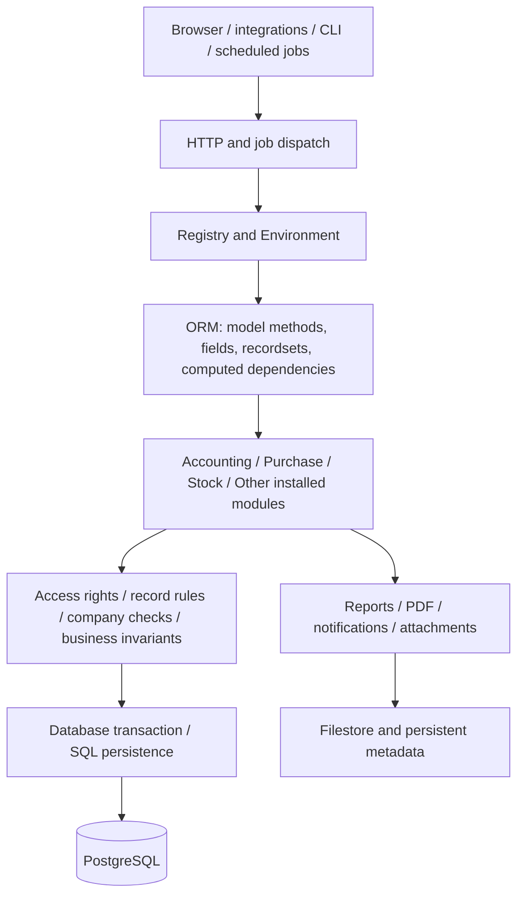

# Odoo 19 — Conceptual Framework Reconstruction

**Scope:** Architecture and accounting workflow explanation grounded in the ProofFlow/Odoo source-research record, supplemented by **Odoo 19 official developer documentation** for uninspected framework internals.  
**Research context:** 6 November 2026.  
**This is a conceptual map, not a claim of completed runtime testing or a full independent reverse-engineering of 60,706 source files.**

## Evidence key and interpretation rule

- **[S] Source-inspected** — code from the Git patch's *complete historical source snapshots*, or an identified code excerpt in preserved terminal evidence. References below give path and line/method; individual Docker revision hash and historical snapshot can differ, so source lines belong to the cited evidence snapshot.
- **[DB] Database-observed** — read-only queries from `odoo19_security_research`, or the user's verified schema-only export. No accounting transactions were available in that research database.
- **[I] Architectural inference** — a reasoned connection implied by documented and inspected methods; *not an executed call trace*.
- **[U] Unverified** — requires source investigation beyond saved excerpts, a separate isolated runtime database, or a user-authenticated scenario.

**Evidence sources:** `commit_changes.patch`, `ProofFlow_Odoo19_Git_Ordered_Research_and_Source_Path_Mirror.zip` (14 complete historical code/config files), `ProofFlow_Research_Checkpoints/Domain*_*.txt` and `*.md`, `Pasted text(20261105-114030).txt` (new Domain 9 observations), and the *user's separately verified* source/framework/schema integrity outputs. The full 1.3 GB TAR, 415 MB ZIP, and the private dependency inventories remain on the user's Windows computer and were not loaded into this analysis environment.

## 1. What system was captured?

The inspected system comprises an Odoo 19 application container (`odoo19-research-app`) and a PostgreSQL 17 container (`odoo19-research-db`). The Odoo installed root is `/usr/lib/python3/dist-packages/odoo`; its standard addon tree is `/usr/lib/python3/dist-packages/odoo/addons`. The configured extra addon path `/mnt/extra-addons` was observed empty. The database is `odoo19_security_research`. [S, DB]

The user **verified** 71,801 source-tree paths in both the installed directory and its TAR inventory (zero missing and zero extra). The reconstruction ZIP contained 60,706 regular files, 19 symbolic links, and 11,076 directories from the TAR; subsequent payload comparison found 60,706/60,706 equal and 19/19 links equal. The schema-only SQL dump contained 458 `CREATE TABLE` statements and passed its checksum check. The 58 corrected research-referenced source paths were recovered with zero remaining paths, though a previous 59-path list included one invalid `account/models/res_partner.py` entry; actual accounting partner extension path was `account/models/partner.py`. [User-observed verification]

**Scope warning:** installed source files are not the same as installed/enabled modules. The installed module registry controls which models exist in the running database. The saved registry evidence confirmed `account 19.0.1.5`, `purchase 19.0.1.2`, `purchase_stock 19.0.1.2`, and `stock 19.0.1.1`. [DB]

## 2. Architectural layers and their responsibilities



Arrows show *conceptual dependencies*, not one mandatory stack-frame order: security checking is distributed through model CRUD and explicit methods, while module loading occurs during registry construction rather than after each incoming request.

### 2.1. User and program entry points [DOC]

The browser-facing web client generally runs at `/web`. It is a single-page application using Odoo's JavaScript framework (including Owl components), action service, views, fields, registries, and RPC service. Form/list/search views are data-driven; buttons can trigger model methods and actions, while a view alone does not prove that a user is authorized. **Source reference for generic client:** `addons/web/static/src/`, described in official docs; this JS folder was present in the captured tree but not independently examined here.  
**Official:** https://www.odoo.com/documentation/19.0/developer/reference/frontend/framework_overview.html

HTTP controllers use `odoo.http.Controller` and `@route()`, with route authentication modes. RPC/action dispatch can reach public model methods. Authenticated APIs and custom integrations are other entrances. These paths pass into Odoo services and the selected database registry. We did not trace the exact installed HTTP dispatcher stack or individual URLs in the local research.  
**Official:** https://www.odoo.com/documentation/19.0/developer/reference/backend/http.html

Scheduled work enters through `ir.cron` jobs; user-triggered work through `ir.actions` and server actions; CLI and maintenance commands are other entry points. This implies that ProofFlow-like controls must be enforced at trusted business/service boundaries, not only UI buttons.  
**Official:** https://www.odoo.com/documentation/19.0/developer/reference/backend/actions.html

### 2.2. Module discovery and assembly [DOC + S]

Every Odoo addon has a `__manifest__.py` declaring dependencies, metadata, loaded XML/CSV data, assets, and optional external dependencies. Dependencies establish loading order. A module can define a new model or extend an existing one. A present folder is not proof of a module being installed.  
**Official:** https://www.odoo.com/documentation/19.0/developer/reference/backend/module.html

The *historical source snapshot* demonstrates extension concretely:

- `purchase/models/purchase_order.py:22` declares `_name = 'purchase.order'`.
- `purchase_stock/models/purchase_order.py:14` declares `_inherit = 'purchase.order'`.
- `purchase_stock/models/purchase_order.py:179` overrides `button_approve()`, calls `super().button_approve()`, then `_create_picking()`.
- `purchase_stock/models/purchase_order_line.py:11` extends `purchase.order.line` and makes received quantity depend on stock movements.

**Architectural consequence:** the same business model can combine contributions from multiple installed addons. An isolated `purchase.order` file is not the complete behavior of the live `purchase.order` registry class. [S, I]

### 2.3. Registry, ORM, environment, and lifecycle [DOC]

Odoo builds a *model registry per database*. Its effective model classes depend on installed modules and inheritance. Business code works with recordsets through an `Environment` carrying the database cursor, user, company, and context. Common model operations include `search`, `browse`, `create`, `write`, and `unlink`. Relational fields connect records; computed fields can depend on changes to other fields; the ORM caches/prefetches records to avoid repeated SQL. [DOC]

Different model families (`Model`, `TransientModel`, `AbstractModel`) serve persistent business records, temporary wizards, and reusable abstract logic. The `@api.depends` and `@api.depends_context` decorators used in the captured purchase and accounting source demonstrate dependency computation, not direct screen-side arithmetic. [S, DOC]

**Source-specific example:** `account/models/account_move_line.py:918` computes product-line `price_subtotal` and `price_total` using `account.tax` routines. It is triggered as a computed-field dependency, while saved dynamic tax lines involve a different synchronization path.  
**Official:** https://www.odoo.com/documentation/19.0/developer/reference/backend/orm.html

### 2.4. Business-method contracts vs database persistence [S + DOC]

One ORM model does not always correspond to a single direct SQL table; stored fields, computed fields, relation tables, and views differ. Odoo's model declarations and ORM map business objects onto PostgreSQL types and constraints. An ORM write can cause recomputations and constraints; transaction handling means a user operation is not equivalent to independently writing a row with SQL. The research schema provided physical columns and relationships, but the 458-table export contained **DDL only**, not business data. [DB, DOC]

## 3. Cross-cutting infrastructure

### 3.1. Security, roles, and company isolation [S + DB + DOC]

The effective authorization boundary combines access control (`ir.model.access`: model CRUD grants), `ir.rule` domains (record-level restrictions), optional field/group restrictions, explicit `has_group` checks, and company consistency. Permissions are not guaranteed by menu visibility. [DOC]

**Observed source:** `account/models/account_move.py:5593` (historical source snapshot) begins posting with an `account.group_account_invoice` membership check unless the environment is superuser, raising `AccessError` on failure. New Domain 9 Command 6 located `_post`, `action_post`, `button_draft`, and associated group/error checks; Command 7 found `_check_company_auto`, `check_company=True`, `with_company`, and `sudo` uses across the accounting models. [S]

**Observed database:** 628 access-control entries, 153 record rules, 50 groups, and two companies; Domain 9 Command 10 reconfirmed these counts in a `BEGIN READ ONLY`/`ROLLBACK` transaction. [DB]

`sudo()` can bypass record access controls; `with_company()` changes the selected company context. Neither guarantees business isolation by itself: concrete read/write domains, company checks and privileged-call sites need examination. A source grep for access rules is **not** a runtime adversarial permission test.  
**Official:** https://www.odoo.com/documentation/19.0/developer/reference/backend/security.html

### 3.2. Taxation, price calculations, and currencies [S + DB]

For invoice product lines, `account.move.line._compute_totals()` (snapshot line 918) calls `account.move._prepare_product_base_line_for_taxes_computation()`, `account.tax._add_tax_details_in_base_line()`, and `account.tax._round_base_lines_tax_details()`, then reads currency-excluded and included totals. Phase 1's preserved notebook additionally followed tax rounding helpers, discounted purchase prices, unit-of-measure conversion, and purchase-to-bill value preparation. [S]

Multi-currency introduces `amount_currency` alongside company-currency `balance`, conversion by relevant date, and potential gain/loss journal consequences on settlement. The source inspection located conversion, rate and exchange-difference paths, but the empty journal/reconciliation tables did not verify live computations. [S, DB]

**Avoid simplification:** `unit_price * quantity` is not sufficient to reproduce Odoo taxes, discounts, fiscal positions, included taxes, rounding, currency and invoice-line display behavior. [S]

### 3.3. Fiscal calendar, journal locks, hashing [S + DB]

`account/models/company.py` includes company fiscal/tax/sale/purchase/hard lock-date logic; `account.move._check_fiscal_lock_dates()` consults company violation checks. The move models also have sequence and hashing/protected-field flows. Domain 6 source and database inspection established configuration fields and user-exception model structures, but **both companies had unset lock dates and no lock-exception rows**. [S, DB]

### 3.4. Communications, documents, and reports [S + DOC]

The captured `purchase.order` and `account.move` declarations inherit `mail.thread`/activity/portal-related mixins; Odoo's mail framework tracks messages, followers, and activities based on configuration. Reports may be rendered as PDF/QWeb via report actions. `ir.attachment` metadata and, depending on setup, filestore data are not interchangeable with plain SQL table structure. [S, DOC]

**Important distinction:** The inspected `account/models/account_report.py` defines `account.report`, `account.report.line`, `account.report.expression`, `account.report.column`, and `account.report.external.value`; the separate `account_reports` and `account_financial_report` addon directories were absent in the inspected path. There were six report-related SQL tables. Thus base report definitions exist, but a full trial balance, P&L or balance-sheet calculation in that installation was **not run and proven**. [S, DB]

### 3.5. Automation and stock scheduling [S + DOC]

The procurement investigation located `stock.rule.run()` at `stock/models/stock_rule.py:453` in the observed Docker source. The historical patch describes route selection, pull/push rule actions and `_run_pull()` construction of moves, subsequent confirmation, company/warehouse context and scheduling dates. It also records blocked caller searches and an unresolved `purchase_delay` origin. The latter is an intentionally open provenance point, not a missing fact that can be invented. [S]

## 4. Accounting business subsystems: the researched data and code graph

| Subsystem | Effective model(s) / fields | Main code paths in saved research | PostgreSQL evidence | Verification level |
|---|---|---|---|---|
| Purchase | `purchase.order`, `purchase.order.line`; `product_qty`, `qty_received`, `qty_invoiced` | `purchase/models/purchase_order.py`, `purchase_order_line.py` | `purchase_order`, `purchase_order_line` tables/columns | Source/schema |
| Procurement | `stock.rule`, `stock.move`, `stock.picking` | `stock/models/stock_rule.py`, `stock_move.py` | `stock_move`, `stock_picking` | Source/schema; some methods from notebook |
| Purchase-stock bridge | Inherits purchase.order and purchase.order.line | `purchase_stock/models/purchase_order.py`, `purchase_order_line.py` | PO/move relations | Complete historical code snapshot |
| Invoice / journal | `account.move`; state, journal, company, type, date | `account/models/account_move.py` `_post`, `action_post`, `_check_balanced` | `account_move` | Source/schema, no posted data |
| Journal line | `account.move.line`; debit, credit, balance, amount_currency, residual | `account_move_line.py` `_compute_totals`, `_compute_debit_credit`, reconciliation | `account_move_line` | Complete historical code snapshot |
| Ledger | `account.account`, `account.journal`, move lines | `account_account.py`, `account_journal.py`, `_compute_cumulated_balance` | `account_account`, `account_journal`, `account_move_line` | Source/schema, no ledger records |
| AP / AR | invoice/refund types, partner and maturity, receivable/payable accounts | `account_move.py`, `account_move_line.py`, `partner.py`, payment terms | `res_partner`, `account_payment_term` etc. | Source/schema |
| Payment registration | `account.payment.register`, `account.payment` | `wizard/account_payment_register.py`, `models/account_payment.py` | `account_payment` | Source discovery/partial method inspection |
| Reconciliation | `account.partial.reconcile`, `account.full.reconcile` | models and `account.move.line._reconcile_plan_with_sync` | partial/full reconcile tables | Source/schema, no rows |
| Multi-currency | `res.currency`, rates, exchange differences | `base/models/res_currency.py`, invoice, wizard methods | `res_currency` and related | Source/schema, conversion runtime missing |
| Fiscal periods | `res.company`, `account.lock.exception`, moves | `company.py`, `account_move.py`, `sequence_mixin.py` | `res_company`, `account_lock_exception` | Source/schema, enforcement untested |
| Financial reporting | `account.report`/line/expression/column | `account/models/account_report.py`, report XML/QWeb | six report-related tables | Definitions inspected; execution untested |
| Assets/depreciation | account types `asset_fixed`, `asset_current`, `asset_non_current` | `account_account.py`; `account_asset` absent | no dedicated asset/depreciation tables under inspected patterns | Scoped negative finding |
| Authorization | `res.users`, `res.groups`, `ir.model.access`, `ir.rule` | `account/security/`, account model company/rights checks | 628 ACL, 153 rules, 50 groups, two companies | Source/schema; no cross-company user test |

This table is a scoped accounting graph, **not** a catalog of every Odoo business module in the 60,706-file capture.

## 5. One continuous operational trace: Purchase order → receipt → bill → ledger → payment

This is the most useful way to see how the system interacts. The sequence shows the potential path with conditions; **it is not a replay of a transaction in the research database**, which had zero journal entries and lines.

### 5.1. The purchasing action enters the server [DOC + S]

A user opens a purchase order in the web client and invokes a confirm action. The UI triggers the model's public business method, rather than directly updating an arbitrary database column. Its effective implementation is composed through installed module inheritance. [DOC]

The historical `purchase/models/purchase_order.py:625` `button_confirm()` checks the current state, validates errors and analytic distribution, and either approves directly or transitions to a `'to approve'` state according to approval policy. [S]

### 5.2. Installed purchase-stock logic adds physical receiving [S]

When a PO becomes approved, the `purchase_stock` override of `button_approve()` calls `_create_picking()` (`purchase_stock/models/purchase_order.py:179`, `:377`). That method prepares or reuses receipt pickings, creates stock moves from order lines, confirms them, assigns available stock, and ties the stock documents back to the originating order. **This is an actual cross-module override, not just a proposed workflow.** [S]

Stock move methods inspected include `_action_confirm()`, `_action_assign()`, `_action_done()` in `stock/models/stock_move.py`. Confirmation may cause procurement rule processing; completion changes the observable quantity state when the applicable move is done. [S]

### 5.3. Received quantity is not a naïve copy of ordered quantity [S]

`purchase_stock/models/purchase_order_line.py:_prepare_qty_received()` aggregates completed moves, converts units of measure, and applies special return/refund/drop-ship conditions. `purchase/models/purchase_order_line.py:_compute_qty_invoiced()` counts bill invoice lines positively and relevant vendor refunds negatively. Billing policy can select ordered-vs-received basis for `qty_to_invoice`. [S]

**Why this matters:** ordered, received, billed and returned quantities are distinct accounting signals. A discrepancy is only meaningful after interpreting the module's status rules, unit conversions and refund paths. [I]

### 5.4. Billing creates financial records with computed taxes [S]

The purchase module's `_prepare_invoice()` prepares invoice values; the accounting module represents supplier bills as `account.move` with a purchase document type (`in_invoice`). Line calculations use tax-base preparation and shared `account.tax` methods. The accounting move and line models also synchronize dynamic tax/payment terms and have company/currency controls. [S]

### 5.5. Posting turns a draft document into ledger entries [S]

`account.move.action_post()` delegates to `_post(soft=False)` for relevant cases. `_post()` checks invoice posting permission and applicable validations. `_check_balanced()` and `_get_unbalanced_moves()` inspect rounded sums of line balances; fiscal-lock logic checks company dates. The posting source then updates relevant state and sequencing information, subject to branch conditions. [S]

**Do not equate:** a draft bill, posted bill, payment, and fully reconciled bill. They are different lifecycle states. [S]

### 5.6. Ledger and receivable/payable state derive from lines [S]

`account.move.line` carries account, journal, move, company, debit, credit, signed balance, optional foreign-currency amount, maturity and residuals. Ledger balance is not the same quantity as reconciliation residual. `_compute_cumulated_balance()` uses a context-dependent SQL window; absent the expected domain/order context it does not act as a universal saved running balance. [S]

### 5.7. Payment and reconciliation settle the obligation [S]

The payment-register wizard builds payment batches and posts payments. `account.payment` has its own state and matching flags. On journal lines, `reconcile()` delegates to a plan which can create `account.partial.reconcile` and `account.full.reconcile` records; exchange-difference and cash-basis tax effects may accompany matching. [S]

Whether an invoice is partially paid, in payment, paid, or otherwise classified depends on source-level payment-state computations and reconciliation relationships, not solely on receipt of an external message. No live payment or bank settlement was executed in the research DB. [S, U]

### 5.8. Permissions, locking, reporting, audit [S + DOC]

Authorization is evaluated throughout these operations; fiscal locks affect posting dates; company context restricts access and relation consistency. Report definitions read/aggregate posted accounting data, and audit/chatter/report rendering can expose a history of the business action. The exact report, approval, and record rule behavior is configuration-dependent. [S, DOC, U]

## 6. Data and transaction architecture, down to PostgreSQL

### 6.1. Business-to-storage mapping [DB + S]

The source snapshot and schema observations establish this central relationship:

```text
purchase.order       → public.purchase_order
purchase.order.line  → public.purchase_order_line
stock.move           → public.stock_move
stock.picking        → public.stock_picking
account.move         → public.account_move
account.move.line    → public.account_move_line
account.payment      → public.account_payment
account.account      → public.account_account
account.journal      → public.account_journal
res.company          → public.res_company
ir.model.access      → public.ir_model_access
ir.rule              → public.ir_rule
```

This is a mapping for **observed ordinary stored models**. It does not mean all Odoo models have direct standalone tables, or that every computed field is a stored column. Record relations may require auxiliary relation tables; some models are views or temporary records. [DOC]

### 6.2. Transaction isolation and ORM invariants [DOC, U]

Under the Odoo framework, a server operation is associated with a database cursor/transaction context; model methods and ORM operations apply business rules before committing persistence. PostgreSQL transactions protect atomic modifications and can roll back failures. The user's research SQL statements were read-only, explicitly `BEGIN READ ONLY` with `ROLLBACK`, so they did **not** exercise Odoo's own transaction lifecycle. The exact installed transaction/retry handling was **not traced** here. [DOC, U]

### 6.3. What the schema and historical database actually proved [DB]

The source-backed `odoo19_security_research` database had **zero** rows in `account_move` and `account_move_line` at the recorded inspection; it contained two companies. The schema export later contained **458 table definitions** and was hashed successfully. Domain 9 recorded 628 ACL entries, 153 record rules and 50 security groups. These facts establish configuration and structure—not behavior of actual posted transactions, authorization denial, or complete reporting. [DB]

### 6.4. Source tree vs runnable system [U]

The integrity-verified source archive, package inventories, Docker image identity and schema DDL are an excellent reproducibility *foundation*. To run a genuinely equivalent Odoo instance, one would additionally need suitable image/runtime configuration, importable dependencies, correct addons state, database data (including the installed-module registry and configurations), appropriate filestore or attachment contents, secrets handled securely, and an isolated deployment test. **The current schema-only archive is not that restored instance.**

## 7. A subsystem-by-subsystem status grid

| Architectural layer | Description confidence | Specific installation evidence | Outstanding verification |
|---|---|---|---|
| Web client/UI | Official Odoo 19 mechanism [DOC] | Full source archive contains web addon, not inspected here | Actual client/action call trace |
| HTTP/CLI/schedulers | Official Odoo 19 mechanism [DOC] | Some stock scheduler/dispatcher source observed | Installed handlers, workers/cron transactions |
| Module loading/registry | Official [DOC] + concrete inheritance [S] | `purchase_stock` overrides found, installed modules recorded | Full effective registry and MRO for all modules |
| ORM/computed fields | Official [DOC] + computed methods [S] | `_compute_totals`, `_compute_qty_invoiced`, residual methods | Recompute, cache/inverse edge cases |
| Purchase/stock | Detailed [S] | Full historical PO and stock-move sources plus stock-rule excerpts | Runtime returns/backorders/procurement branches |
| Taxes/currencies | Substantial [S] | Phase 1 notebook; Domain 5 | Tax/currency runtime fixtures |
| Posting/ledger | Detailed [S] | `account_move.py`, `account_move_line.py`; schema | Real posting and balancing fixtures |
| AP/AR/payments | Substantial [S] | Domains 3–4, payment register and reconciliation references | Partial/complete/FX settlement fixtures |
| Fiscal security | Substantial [S, DB] | Domains 6, 9; 628 ACL/153 rules/50 groups | Authenticated multi-company tests |
| Reports | Model definitions [S, DB] | Base `account.report` models; six tables | Full report engine and output calculations |
| Fixed assets | Negative scoped evidence [S, DB] | Dedicated `account_asset` absent in inspected install | Optional module or external asset processes |
| PostgreSQL | Strong schema [DB] | 458 DDL tables, installed modules, two companies | Schema restore + full data and app execution |

## 8. Evidence-to-method crosswalk (do not merge historical stages)

**October 29–30 — foundation.** Git patch first reachable commit `27bd543`; early inventory through DB-031 and DB-036, extracted model fields, complete source snapshots, SHA-256 manifest and research status. The original workspace-creation commands still cannot be recovered verbatim from these commits.

**November 2 — Phase 1 (price/tax).** `238cb1a` preserved the temporary notebook: `_compute_totals()`, invoice tax-base preparation, `account.tax` rounding, discounts, price/UoM conversion. *Original Phase 1 is different from the later nine-domain Domain 1.*

**November 2–3 — procurement.** Commits `a8ecda2` and `4967ae4` locate `stock.rule.run`; subsequent commits inspect rule precedence, intercompany routing, `_run_pull`, procurement serialization, lead times and unresolved `purchase_delay` source. The Git patch is a strong chronology of *investigations*, not necessarily raw output for each grep.

**November 4 — nine domains.** `Domain1`–`Domain9` checkpoints record journal posting, GL, AP/AR, payments, multi-currency, closing, assets, reporting, and security. Source and schema inspection are separate from any transaction tests.

**November 5 — new Domain 9 evidence.** Recovery outputs for Commands 6–10 establish explicit authorization paths, `sudo`/company-context locations and security metadata counts; do not backdate them as part of the original November 4 evidence.

**November 6 — archive verification.** The user verified 58 corrected recovered source paths, full 71,801 path capture, 60,706 exact payload comparisons, 19 link comparisons, 35 supporting evidence hashes, and 458 database table definitions. These verify provenance and integrity, not accounting runtime correctness.

## 9. Conceptual implications for ProofFlow (not an implementation plan)

**Lesson 1:** The system of record is not just the UI; authorization, posting checks, and quantity derivations live in model methods and ORM/database contexts. A separate exception system needs stable extraction points and traceable evidence, not inferred screen labels.

**Lesson 2:** A discrepancy requires a normalized business interpretation: ordered and invoiced quantities, net returns, source unit of measure, applicable billing policy, product type, company, tax/discount and currency context.

**Lesson 3:** Posting validity, payment status, residual amount, ledger balance, and reconciliation state are different business concepts. They cannot be represented by one generic `is_valid` flag.

**Lesson 4:** Source inspection can define test hypotheses; it cannot certify outcomes for companies, journals, currencies, locks or payment states that have never been exercised with controlled data.

**Lesson 5:** Research revision, live source tree, schema snapshots and runtime observations should carry independent provenance so historical evidence is never overwritten by a later Docker capture.

## 10. References and navigation

### Original research files (provided in this conversation)

- `ProofFlow_Odoo19_Git_Ordered_Research_and_Source_Path_Mirror.zip` — 14 exact, complete historical source snapshots in their mapped addon hierarchy; 32 commit records and research indexes.
- `commit_changes.patch` — 32 recorded Git commits and their actual additions/changes.
- `ProofFlow_Research_Checkpoints/Domain1_Consolidated_Research_Findings.md` through `Domain4_Consolidated_Research_Findings.md`, plus Domain 5–9 command transcripts.
- `Pasted text(20261105-114030).txt` — newly executed recovery and Domain 9 Commands 6–10 results.
- `ProofFlow_Odoo19_Methodological_Research_Library/08_financial_reporting/COMMAND_02_QUESTION_METHOD_OUTPUT_DECISION.md` — specific command/output/reasoning example.
- The user's verified local archive and schema, **not mounted in this analysis environment**: `~/Odoo19_Private_Capture/framework_20261106T093717Z/source_archive/odoo-installed.tar` and `~/Odoo19_Private_Capture/final_reconstruction/ProofFlow_Odoo19_System_Reconstruction.zip`.

### Official Odoo 19 architectural documentation (used only where original research did not directly examine core internals)

- Web client: https://www.odoo.com/documentation/19.0/developer/reference/frontend/framework_overview.html
- Controllers: https://www.odoo.com/documentation/19.0/developer/reference/backend/http.html
- Addon manifests: https://www.odoo.com/documentation/19.0/developer/reference/backend/module.html
- ORM API: https://www.odoo.com/documentation/19.0/developer/reference/backend/orm.html
- Security: https://www.odoo.com/documentation/19.0/developer/reference/backend/security.html
- Actions and cron: https://www.odoo.com/documentation/19.0/developer/reference/backend/actions.html
- Mail / activities mixins: https://www.odoo.com/documentation/19.0/developer/reference/backend/mixins.html
- Testing methods: https://www.odoo.com/documentation/19.0/developer/reference/backend/testing.html

**Final research conclusion:** The Odoo 19 system can now be explained coherently as a modular framework with action/HTTP/job entry points, database-specific registry, ORM/fields, extensible business models, cross-cutting security/tax/currency/lock controls, and PostgreSQL persistence. The saved research supports unusually detailed purchase-to-receipt-to-bill-to-ledger-to-reconciliation traces. Exhaustive module-by-module implementation analysis and authenticated production-equivalent runtime behavior remain **unverified**, and this report does not pretend otherwise.
